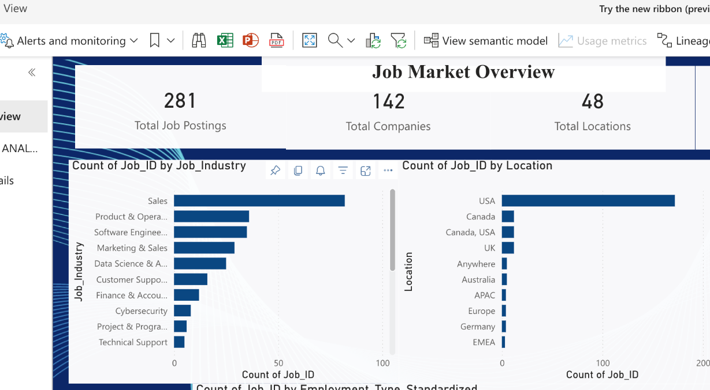
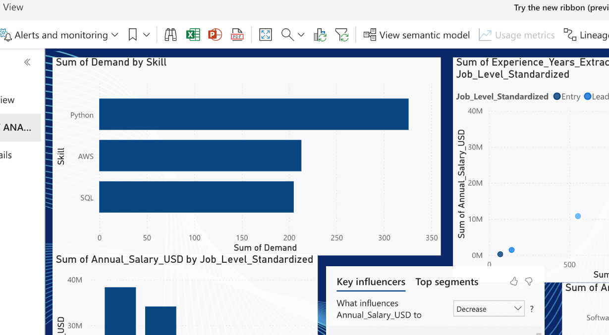
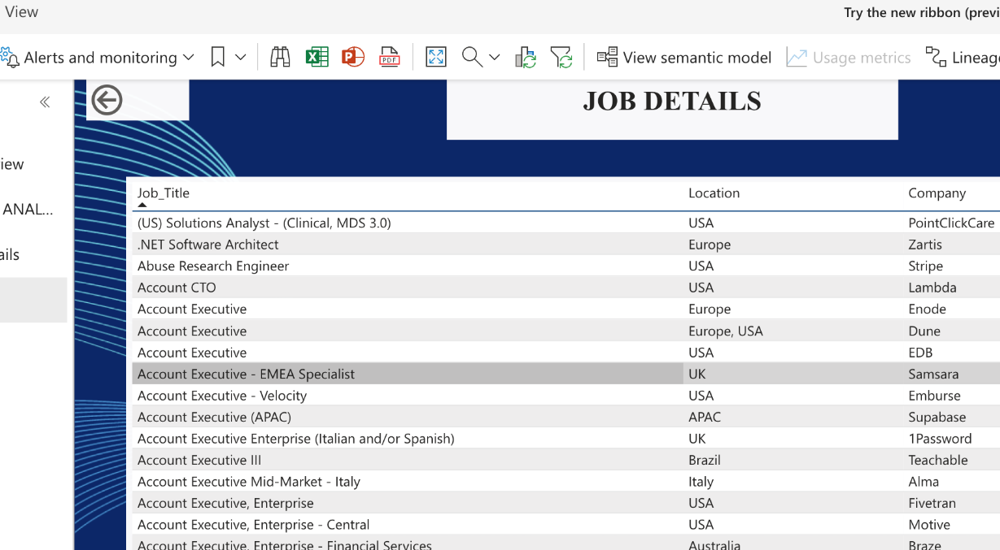

# 📊 Job Market Analytics
### Turning Job Market Data into Actionable Insights

An end-to-end **Data Analytics and Machine Learning** project that explores remote job-market trends, identifies in-demand technical skills, analyzes salary patterns, and predicts salaries using Machine Learning. The project combines Python-based data processing with an interactive Power BI dashboard.

---

## 🚀 Project Overview

Job Market Analytics transforms publicly available job postings into meaningful insights about the evolving employment landscape.

Using the **Jobicy Public Remote Jobs API**, the project collects job listings and processes them through data cleaning, feature engineering, exploratory data analysis (EDA), and predictive modeling.

The results are presented through an interactive Power BI dashboard, allowing users to explore job opportunities across industries, companies, locations, skills, experience levels, and salary ranges.

## 📈 Project Highlights

| Metric | Result |
|---|---:|
| Job postings analyzed | 1,021 |
| Unique companies | 290 |
| Location categories | 116 |
| Processed dataset fields | 61 |
| Skill indicators | 30+ |
| Salary records | 510 |
| Machine learning algorithm | Random Forest |

## ✨ Key Features

### 1. Data Collection
- Integrated the Jobicy Public Remote Jobs API using Python.
- Collected job postings across multiple keywords and industries.
- Processed JSON API responses into structured datasets.
- Removed duplicate records using unique Job IDs.

### 2. Data Cleaning & Preprocessing
- Handled missing and inconsistent values.
- Removed HTML tags and unnecessary formatting from job descriptions.
- Standardized employment types and job levels.
- Converted salary values into annual equivalents.
- Processed dates and categorical variables.

### 3. Feature Engineering
- Extracted experience requirements using Regular Expressions.
- Created 30+ skill-specific binary indicators.
- Calculated Skill Count, Description Length, and Word Count.
- Prepared analytical features for exploratory analysis and machine learning.

### 4. Exploratory Data Analysis (EDA)

Analyzed:
- Industry-wise job distribution.
- Most demanded technical skills.
- Salary distribution and compensation patterns.
- Experience requirements across job levels.
- Employment type and geographic distribution.
- Relationships between skills, experience, and salary.
- Job posting trends over time.

### 5. Machine Learning – Salary Prediction

Implemented a **Random Forest Regression** model to estimate annual salaries in USD.

**Model configuration**

| Setting | Value |
|---|---|
| Algorithm | Random Forest Regressor |
| Number of estimators | 100 |
| Train-test split | 80:20 |
| Categorical encoding | One-Hot Encoding |
| Evaluation metrics | RMSE, MAE, R² Score |

**Model performance**

| Evaluation metric | Result |
|---|---:|
| RMSE | $68,289.40 |
| MAE | $51,715.36 |
| R² score | 0.2493 |
| 5-fold CV mean R² | -0.0299 |

The model is an initial predictive baseline. Its performance indicates that salary prediction requires additional features and further optimization.

### 6. Interactive Power BI Dashboard

The Power BI report contains four pages:
- **Job Market Overview** – KPI cards and job distribution by industry, location, and employment type.
- **Skills & Salary Analysis** – skill demand, salary by job level and industry, and Key Influencers.
- **Trends & Job Details** – trends and detailed job-market exploration.
- **Job Details** – tabular view of individual job postings.

The report also includes interactive filtering, drill-through navigation, and comparative visualizations.

#### Dashboard Preview

**Job Market Overview**



**Skills & Salary Analysis**



**Job Details**



## 🛠️ Technology Stack

| Technology | Purpose |
|---|---|
| Python | Programming and data processing |
| Pandas | Data manipulation and cleaning |
| NumPy | Numerical computations |
| Requests | API integration |
| BeautifulSoup | HTML parsing and text cleaning |
| Matplotlib | Data visualization |
| Seaborn | Statistical visualization |
| Scikit-learn | Machine Learning |
| Jupyter Notebook | Analysis and experimentation |
| Power BI | Interactive dashboards |

## 🔄 Project Workflow

```text
       Jobicy Public API
              |
              v
       Data Collection
              |
              v
        Raw Dataset
              |
              v
     Data Cleaning & ETL
              |
              v
      Feature Engineering
              |
              v
    Exploratory Data Analysis
              |
        +-----+------+
        |            |
        v            v
   Machine       Visualizations
   Learning           |
        |             |
        v             |
  Salary Prediction   |
        |             |
        +------+------+
               |
               v
       Power BI Dashboard
               |
               v
       Actionable Insights
```

## 📁 Repository Structure

```text
Job-Market-Analytics/
│
├── 01_web_scraping_job_market.py
├── 02_data_analysis_and_modeling.ipynb
├── raw_job_market_data.csv
├── cleaned_job_market_data.csv
├── Final_Project.pbix
├── assets/
│   ├── dashboard-overview.png
│   ├── skills-salary-analysis.png
│   └── job-details.png
├── README.md
└── requirements.txt
```

## ⚙️ Installation & Setup

### Prerequisites
- Python 3.9+
- Jupyter Notebook
- Power BI Desktop (for dashboard exploration)

### 1. Clone the repository

```bash
git clone https://github.com/IshaanSahi/JOB-MARKET-ANALYTICS.git
cd JOB-MARKET-ANALYTICS
```

### 2. Create a virtual environment (recommended)

```bash
python -m venv venv
```

Activate it:

**Windows**
```bash
venv\Scripts\activate
```

**macOS / Linux**
```bash
source venv/bin/activate
```

### 3. Install dependencies

```bash
pip install -r requirements.txt
```

### 4. Run data collection

```bash
python 01_web_scraping_job_market.py
```

This executes the API-based data collection script and generates the raw CSV dataset.

### 5. Run the analysis

```bash
jupyter notebook
```

Open `02_data_analysis_and_modeling.ipynb` and run the notebook cells sequentially to perform data cleaning, preprocessing, feature engineering, exploratory data analysis, and salary prediction.

### 6. Explore the dashboard

Open `Final_Project.pbix` using Microsoft Power BI Desktop.

## 📊 Key Insights

The analysis revealed several patterns within the collected dataset:

- Software Engineering represented the largest job-industry category.
- Python, AWS, Machine Learning, and SQL were among the most frequently detected technical skills.
- Full-time positions dominated the collected job postings.
- Job listings showed a concentration of postings from the USA.
- Experience alone showed a relatively weak relationship with salary.

These findings describe the collected dataset and should not be generalized to the entire global employment market.

## 🔮 Future Improvements

- **Broaden data coverage:** Integrate additional job-market APIs and data sources to increase the number and diversity of postings.
- **Improve data quality:** Strengthen salary validation, currency normalization, duplicate detection, and handling of inconsistent job metadata.
- **Enhance skill extraction:** Use NLP techniques to identify skills, tools, and technologies from job descriptions beyond the current keyword-based indicators.
- **Improve salary prediction:** Compare models such as XGBoost and Gradient Boosting, tune hyperparameters, and evaluate models with cross-validation.
- **Strengthen feature engineering:** Explore additional job-description, company, location, seniority, and skill-combination features.
- **Automate data refreshes:** Schedule periodic data collection and dashboard refreshes so the analysis can be updated with newer postings.
- **Build a web application:** Create an interactive web interface for searching, filtering, and exploring job-market insights.
- **Add job recommendations:** Recommend relevant roles based on a user's skills, experience, and preferred job category.

## 📚 Data Source

**Jobicy Public Remote Jobs API**

https://jobicy.com/api/v2/remote-jobs

The project uses publicly available job-posting information for educational and analytical purposes. Data availability and API responses may change over time.

## 👨‍💻 Author

**Ishaan Sahi**  
B.Tech – Computer Science & Engineering  
Jaypee Institute of Information Technology, Noida

---

⭐ If you find this project interesting, consider giving the repository a star!
